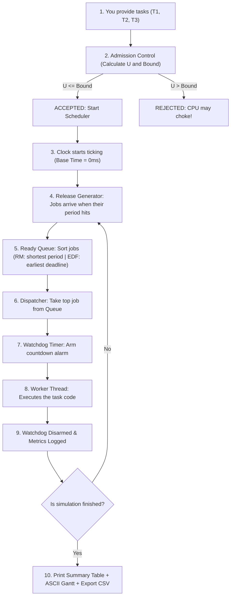

# RTSched: Real-Time Task Scheduler (Explained in Plain & Simple Words)

> **"What is this project, what goes in, what comes out, and what happens in between?"**
> If you felt confused by all the theory, this guide is written specifically for you in simple, everyday language with no jargon left unexplained.

---

## 1. The 10-Second Elevator Pitch

Imagine an **airplane autopilot** or a **self-driving car**:
* Every **50 milliseconds**, it must read the camera and obstacle sensors.
* Every **100 milliseconds**, it must calculate speed and steering angle.
* Every **200 milliseconds**, it sends diagnostic data to the dashboard screen.

If the obstacle sensor task runs **10 milliseconds too late**, the car crashes! In real-time computing, being late is just as bad as being wrong.

**This project (`RTSched`) is the CPU "Traffic Police" (Scheduler)**. 
You give it a list of real-world jobs with deadlines, and it:
1. **Calculates upfront with math** whether the CPU can finish everything on time without crashing.
2. **Decides who gets the CPU first** (prioritizing tasks by frequency or urgency).
3. **Runs them in real time** on a background thread.
4. **Guards them with a Watchdog timer** so that if one task freezes, it gets caught immediately.
5. **Prints a visual timeline (Gantt chart)** and statistics showing exactly what happened down to the millisecond.

---

## 2. What is the INPUT? (What you feed into it)

The input is simply a list of tasks you want the computer to run periodically.

### The 4 Main Ingredients of each Task:
| Input Parameter | Plain English Meaning | Example in a Car |
| :--- | :--- | :--- |
| **`name`** | What is this task called? | `"ObstacleCamera"` |
| **`period_ms`** | How often does it repeat? (in milliseconds) | Run every `50 ms` (20 times per second) |
| **`wcet_ms`** | **W**orst-**C**ase **E**xecution **T**ime: How long does the task take to run when working hardest? | Takes `10 ms` of CPU work |
| **`deadline_ms`** | By when must it finish? | Must finish within `50 ms` from when it arrives |

### Plus 2 Configuration Inputs:
* **`Policy`**: Which scheduling rule to follow?
  * **`RM` (Rate-Monotonic)**: "Tasks that repeat most frequently get the highest priority." (Static rule).
  * **`EDF` (Earliest Deadline First)**: "Whoever's deadline is closest right now gets the CPU first." (Dynamic rule).
* **`duration_ms`**: How long to run the simulation? (e.g., `1000 ms` = 1 second).

### Exact Code Example of Input:
```cpp
std::vector<Task> tasks = {
    Task("T1_Sensor",   50, 10),   // Repeats every 50ms, takes 10ms CPU
    Task("T2_Steering", 100, 20),  // Repeats every 100ms, takes 20ms CPU
    Task("T3_Display",  200, 40)   // Repeats every 200ms, takes 40ms CPU
};
```

---

## 3. What is the OUTPUT? (What you see on the screen & file)

When you run the program, it produces **4 clear outputs**:

### Output 1: Admission Check (The Math Verdict)
Before running a single line of code, the system calculates whether the CPU will choke:
```
[Admission] Policy: RM | U = 0.6000 | Bound = 0.7798 -> ACCEPTED
```
* `U = 0.6000`: Your tasks will take 60% of CPU capacity.
* `Bound = 0.7798`: Safety limit for RM policy is ~78%.
* `ACCEPTED`: Math guarantees zero missed deadlines!

### Output 2: Live Execution Summary Table
After running for 1 second, it prints a scorecard of every task:
```
=================== TIMING MONITOR SUMMARY ===================
Task      Jobs      Misses    Avg Jitter(ms) Max Jitter(ms) Overruns  
--------------------------------------------------------------
T1        20        0         0.15           1.00           0         
T2        10        0         10.20          11.00          0         
T3        5         0         30.10          31.00          0         
==============================================================
```
* **Jobs**: How many times each task ran (e.g., T1 ran 20 times in 1000ms because 1000 / 50 = 20).
* **Misses**: `0` (Zero tasks missed their deadline).
* **Jitter**: How long a task had to wait in line before starting.
* **Overruns**: `0` (No task went rogue and ran longer than allowed).

### Output 3: Visual ASCII Timeline (Gantt Chart)
It draws a character-by-character timeline of who was using the CPU:
```
Execution Gantt Chart (1 char = 5 ms):
T1      |##........##........##........##........|
T2      |..####......####......####..............|
T3      |......########..........########........|
```
* `#` = Task is running right now on the CPU.
* `.` = Task is idle, waiting, or asleep.

### Output 4: CSV File (`timeline.csv`)
It creates a file you can open in Excel:
```csv
task,start_ms,end_ms
T1,0,10
T2,10,30
T3,30,70
T1,50,60
```

---

## 4. The Math Formulas: Why do we have them & what do they calculate?

Why do we need math before running tasks? **Because you never want an airplane or car to start driving if the CPU is guaranteed to freeze!**

### Formula 1: CPU Utilization ($U$)
> **Question it answers:** "In total, what percentage of the CPU's time do these tasks demand?"

$$\text{Utilization } (U) = \sum \frac{\text{Execution Time } (C_i)}{\text{Period } (T_i)}$$

* $C_i$ = Worst-case execution time (how long it runs).
* $T_i$ = Period (how often it repeats).

#### Step-by-Step Calculation with our example:
* **Task 1**: Takes 10ms every 50ms $\rightarrow \frac{10}{50} = 0.20$ (20% CPU)
* **Task 2**: Takes 20ms every 100ms $\rightarrow \frac{20}{100} = 0.20$ (20% CPU)
* **Task 3**: Takes 40ms every 200ms $\rightarrow \frac{40}{200} = 0.20$ (20% CPU)
* **Total $U$** = $0.20 + 0.20 + 0.20 = \mathbf{0.60}$ (**60% CPU workload**).

---

### Formula 2: Liu & Layland Schedulability Bound (For RM Policy)
> **Question it answers:** "If I prioritize tasks simply by who repeats fastest (RM), is 60% workload safe, or will tasks clash and miss deadlines?"

$$\text{Bound} = n \cdot \left(2^{1/n} - 1\right)$$

Where $n$ is the number of tasks.

* For $n = 1$ task: $1 \cdot (2^{1/1} - 1) = 1.00$ ($100\%$)
* For $n = 2$ tasks: $2 \cdot (2^{1/2} - 1) \approx 0.828$ ($82.8\%$)
* For $n = 3$ tasks: $3 \cdot (2^{1/3} - 1) \approx \mathbf{0.7798}$ ($\mathbf{77.98\%}$)
* For $n \to \infty$ tasks: Approaches $\ln(2) \approx \mathbf{69.3\%}$

#### The Decision:
* Our CPU load $U = 0.60$ (60%).
* The safety bound for 3 tasks is $0.78$ (78%).
* Because **$0.60 \le 0.78$**, the scheduler says: **`ACCEPTED`**. Math guarantees **100% of deadlines will be met**.

---

### Formula 3: EDF Schedulability Bound (For Earliest Deadline First)
> **Question it answers:** "What if I use dynamic priority where the closest deadline always wins?"

$$\text{EDF Bound} = \mathbf{1.00} \text{ (100\%)}$$

* EDF is optimal. If your tasks require up to 100% of the CPU ($U \le 1.0$), EDF can successfully schedule all of them without missing any deadline!

---

### Formula 4: Timing Metrics (How good is the execution?)
During and after execution, the monitor measures:
1. **Release Jitter**: 
   $$\text{Jitter} = \text{Actual Start Time} - \text{Scheduled Release Time}$$
   *(How long a task sat in line waiting before the CPU picked it up).*
2. **Turnaround Time (Response Time)**:
   $$\text{Response Time} = \text{Finish Time} - \text{Release Time}$$
   *(From the moment the job arrived until it was completely finished).*
3. **Overrun**:
   $$\text{Overrun} = (\text{Finish Time} - \text{Start Time}) - \text{WCET}$$
   *(Did the task take longer than it promised? If $> 0$, it's an overrun).*

---

## 5. Step-by-Step: How the Code Processes Everything

Here is the exact step-by-step journey of what happens inside the code when you click Run:



### Detailed Breakdown of the Steps:

#### Step 1: The Input Handshake
In `src/main.cpp`, you define your tasks and hand them to `Scheduler`.

#### Step 2: Admission Control (`src/policy.cpp`)
The function `check_admission()` runs. It adds up all $C_i / T_i$. If under the bound, it greenlights the run.

#### Step 3: Clock Starts & Job Release (`src/scheduler.cpp`)
A background thread starts. At time $t = 0\text{ ms}$:
* `T1` arrives (Job 1)
* `T2` arrives (Job 1)
* `T3` arrives (Job 1)
All 3 jobs are placed into the **Ready Queue**.

#### Step 4: Priority Sorting (`src/policy.cpp`)
The Ready Queue uses `JobComparator`:
* Under **Rate-Monotonic (RM)**:
  * `T1` has period 50ms (runs fastest $\rightarrow$ **Highest Priority #1**)
  * `T2` has period 100ms $\rightarrow$ **Priority #2**
  * `T3` has period 200ms $\rightarrow$ **Priority #3**
* Result: `T1` gets the CPU first!

#### Step 5: Execution & Watchdog (`src/watchdog.cpp`)
Before `T1` starts running:
* The **Watchdog** is notified: *"T1 is starting, it should take 10ms."*
* If T1 hangs and takes 50ms, a separate Watchdog thread wakes up, triggers an alert, and executes a recovery routine.
* When T1 finishes normally at $10\text{ms}$, the Watchdog is disarmed.

#### Step 6: Next in Line
* At $t = 10\text{ms}$, `T1` is done. `T2` gets the CPU (runs from $10$ to $30\text{ms}$).
* At $t = 30\text{ms}$, `T2` is done. `T3` gets the CPU (runs from $30$ to $50\text{ms}$).
* At $t = 50\text{ms}$, `T1` arrives again! Because `T1` has higher priority, it runs immediately.

#### Step 7: Final Reporting (`src/monitor.cpp` & `src/gantt.cpp`)
When the run finishes:
* `DeadlineMonitor` counts up all jitter, misses, and execution times.
* `print_text_gantt()` draws the `#` and `.` ASCII timeline.
* `export_timeline_csv()` writes rows to `timeline.csv`.

---

## 6. The 4 Demo Scenarios Built Into the Project

When you test the program, it has 4 pre-made scenarios to prove each feature:

| Scenario | Command | What it demonstrates | What to look for |
| :--- | :--- | :--- | :--- |
| **1. Standard RM** | `.\build\Release\rtsched_demo.exe rm` | Normal Rate-Monotonic scheduling with 60% CPU load. | All tasks pass with 0 misses. |
| **2. Standard EDF** | `.\build\Release\rtsched_demo.exe edf` | Same tasks running under Earliest-Deadline-First dynamic priority. | Jobs ordered dynamically by nearest deadline. |
| **3. Rejection vs Acceptance** | `.\build\Release\rtsched_demo.exe reject` | Heavy task set with $85\%$ CPU load ($U = 0.85$). | **RM rejects it** ($0.85 > 0.78$), but **EDF accepts it** ($0.85 \le 1.0$)! Shows why EDF is more powerful. |
| **4. Fault & Watchdog** | `.\build\Release\rtsched_demo.exe fault` | A bug is injected into `T1` on its 3rd run so it hangs 5x longer. | Watchdog catches it and triggers `RECOVERY: task T1 exceeded limit`! |

---

## 7. Quick Summary Cheat-Sheet

* **Input**: A list of periodic tasks (Name, Repeat Interval, Computation Workload, Deadline).
* **Formula**: $U = \sum (C_i / T_i)$ must be $\le \text{Bound}$ (78% for RM 3-tasks, 100% for EDF).
* **Processing**: Ready Queue sorts by priority $\rightarrow$ Dispatcher runs top job $\rightarrow$ Watchdog guards timeout $\rightarrow$ Monitor logs timestamps.
* **Output**: Math verdict (`ACCEPTED`), ASCII visual timeline (`Gantt`), Statistics table (`Jitter & Misses`), and Excel-ready file (`timeline.csv`).
